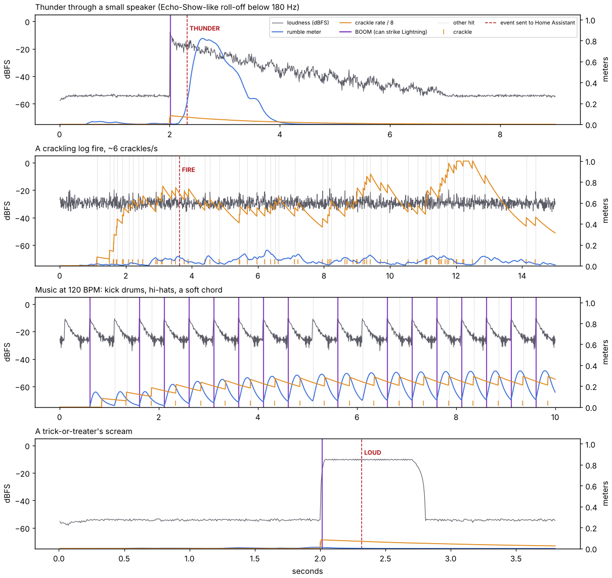

# How it hears

This is the reasoning behind `SoundAnalyzer`, including the parts that didn't work the first
time. All numbers come from the host test bench (`tools/hosttest`): the real firmware compiled
on a PC and fed synthetic sound. That means they describe *models* of thunder, fire, music and
screams, not your porch. The *Mic sensitivity* control and the OLED meter exist to close that
gap.



*Top to bottom: thunder through a small (Echo-Show-like) speaker, a log fire, music at
120 BPM, a scream. Violet lines are **booms** (they may strike Lightning), dotted grey lines are
other hits, orange ticks are crackles, and red dashed lines are events sent to Home Assistant.*

## 1. Getting samples

* The Grove mic idles at about half its supply and swings around it. The ESP32-C6's ADC1 runs in
  **continuous DMA mode at 32 kHz** (12 dB attenuation, roughly 0–3.1 V).
* The Arduino `analogContinuous()` helper only returns *averages per conversion frame*, which
  throws away the very transients we're after. So `MicInput` uses the ESP-IDF
  `adc_continuous` driver directly.
* A FreeRTOS task (priority 3: above `loop()`, below the Zigbee stack) averages sample pairs. That
  gives 16 kHz, a gentle anti-alias filter, and half the ADC noise power. It then feeds the
  analyser 128 samples at a time, one 8 ms frame.

### No microphone

An empty Grove port with no pull would float, and a floating ADC pin wanders and spikes. The
firmware enables the pin's internal pull-down (~45 kΩ) after the ADC driver has configured the
pad, so an empty port reads 0 V. The Grove mic's amplifier output holds its ~half-supply bias
easily against that.

Every 0.25 s the analyser looks at the raw peak:

* **Peak < 200 counts:** that window is empty. The first such window, or 4 in a row once a mic
  has been seen, means *absent*. The analyser then emits nothing (no hits, crackles, events,
  level or rumble), so only remote cues drive the effects.
* **Any other window:** *present*. If the mic was absent before, the analysis **restarts**: the
  DC tracker re-snaps to the new bias, and the filters, references and warm-up start over.
  Without that, the jump from 0 V to the mic's bias would pass the DC tracker as a huge, slow
  "bang".

Tested: 20 s of empty port, with and without 20 switching-noise spikes per second, gives
nothing. Plugging a mic in mid-show gives no phantom hit, then the next thunderclap is heard and
reported. Pulling it out gives silence, with the mic marked absent 0.99 s later.

### On the Gledopto (ESPHome)

[Spooky Overhead](https://github.com/rightiswrong/esp32-overhead-spooky-lighting) runs this same analyser on a classic ESP32 through ESP-IDF's
continuous ADC driver (on IO33, ADC1), at the same 32 kHz and 12 bits. `SoundBus.h` includes
FreeRTOS directly when there's no Arduino core, so the shared files build there unchanged.

## 2. Bands, in fixed point

The C6 has no FPU, so the per-sample work is integer: about 10 multiply-accumulates per sample,
roughly 1 % of the CPU.

```
y  = (raw << 8) − DC tracker                      (Q4, ±32768)
low  = 2 × one-pole low-pass  @ 300 Hz            a = 1 − e^(−2π·300/16000) = 0.1111 → 3642/32768
mid  = 2 × bilinear high-pass @ 300 Hz            k = tan(π·300/16000), b0 = 1/(1+k), a1 = (1−k)/(1+k)
high = 2 × bilinear high-pass @ 2 kHz             k = tan(π/8) = 0.4142 → b0 = 0.7071, a1 = 0.4142
```

**Dead end #1: "high-pass = y − low-pass".** The first high band was `y − LPF(y)` with a
one-pole low-pass at 2 kHz. With the corner at fs/8, a one-pole low-pass still has gain 0.37
at Nyquist, so its complement passes only about 0.6× amplitude even at the highest frequencies.
Crackles therefore looked half as "hissy" as they are (high share capped near 0.3), and Lightning
struck on fire crackles. A bilinear section has exactly unity gain at Nyquist.

**Dead end #2: "mid = E_all − E_low".** The low-pass lags in phase, so `y` and `low` aren't
orthogonal. On bass notes the energy difference swung between zero and huge from frame to frame,
which produced fake onsets that then blocked real kick drums (13 of 20 detected). Mid is now its
own high-pass.

## 3. Onsets ("hits")

Per 8 ms frame, mean-square energy per band. A hit is an onset in either view:

* **mid band (> 300 Hz):** `E > 4·B` and `E > 2 × previous frame`
* **bass (< 300 Hz), averaged over 24 ms:** `E > 4·B` and `E > 1.6 × previous`

`k = 4` is about +6 dB at sensitivity 50, and every threshold scales by 2^((50 − s)/16).

**Dead end #3: judging against a noise floor.** The first reference fell fast and rose slowly,
a classic noise-floor tracker. But a chord's three close notes beat against each other, and their
8 ms energy swings about 5× at ~50 Hz. A floor sitting in the troughs sees every crest as an
onset. Onsets are now judged against **B, the running mean** (up in ~0.5 s, down in ~0.25 s),
which is frozen for a few frames around each hit so the bang doesn't raise its own bar.

Bass gets a 24 ms window because 8 ms holds only a cycle or two of a 150 Hz roar, whose
per-frame energy then jitters like a chi-square variable with very few degrees of freedom. A
fire's roar would otherwise "hit" about once a second.

The hit is reported once its **peak frame** is known: the onset frame, or the next one if the
onset straddled a frame boundary. It carries:

* **strength** = log2(E/B)/6, clamped to 0–1;
* the **low and high share** of the peak frame's energy;
* **persistence** = energy in the frame after the peak ÷ peak energy.

## 4. Booms vs crackles

Can spectrum alone tell a fire crackle from a thunderclap at onset? The test bench says no:
crackle high-share runs 0.5–0.8, thunder crack 0.36–0.47, which is too close to rely on.
**Duration** separates them cleanly. A crackle lasts 2–4 ms and the next frame collapses. A
thunderclap's crack is followed by its body swelling in. Measured over 6 seeds × 4 levels × 2
speakers × 9 fire variants:

| | fire crackles (2,242 hits) | thunder onsets (48) |
|---|---|---|
| persistence | max **1.00** | min **1.15** |

So a **boom** is: persistence ≥ 1.05 and high share < 0.6. Booms strike Lightning, gutter the
candles and set the Heart. Crackles flare individual flames. The trade-off is that an impulse,
like a lone door slam or a knock, is not a boom. For jump scares, Home Assistant can send a
thunder cue.

Crackles have their own detector on the high band (`E_high > 6·B_high` and > 2.5× the previous
frame), whose running mean also ignores crackle frames. Recall is about 90 % with no false
crackles in the fire test. A missed crackle just means one fewer spark.

## 5. Telling Home Assistant what it heard

Only booms are classified, 0.3 s after the fact, once we know how they rang on:

* **THUNDER**: strength ≥ 0.4, aperiodic, and **sustain** ≥ 0.5. Sustain is the energy above
  the pre-hit background still present 0.22–0.30 s later, relative to the peak, taken as the
  **median** of those frames.
* **LOUD (a scream)**: strength ≥ 0.6, sustained, and **periodic**.
* **FIRE**: ≥ 2 crackles per second for 2 s with no booms.

| | music booms (1,069) | thunder, first boom (35) |
|---|---|---|
| sustain | max **0.42** | min **0.71** |

**Dead end #4: the mean of the tail.** At 120 BPM the hi-hat lands 0.25 s after each kick,
exactly inside the kick's tail window. Two kick drums a run were reported as thunder. The
median ignores a transient passing through.

**Dead end #5: every boom restarts the window.** A rolling rumble swells and makes weaker booms,
which stole the classification from the crack and then failed the test themselves (3 of 24
thunder runs reported nothing). Only a boom at least 90 % as strong restarts the window now.

**Periodicity** is the best normalised autocorrelation of the last 32 ms of the mid band, at lags
of 5–12.5 ms: voice 0.89, white noise 0.19, and the 200–500 Hz noise that's left of thunder after
a small speaker 0.24. Lags start at 5 ms because narrow-band noise *does* correlate over a
millisecond or two, while a voice keeps repeating. It costs about 47k integer MACs once per boom.

## 6. Rumble and level

* **Rumble** compares the low band, smoothed over ~0.1 s, with a slow floor (falls in 1 s, rises
  in 8 s, learns quickly for the first 2 s). It is weighted by how bass-heavy the sound is,
  using the *energy-weighted* low share.
  * **Dead end #6:** without that weight, a scream's harmonics leaking below 300 Hz drove the
    rumble to 1.0, and a 1.6 s scream would have been reported as distant thunder.
  * **Dead end #7:** a smoothed *ratio* still remembered the quiet room (whose noise is 30 % "low")
    at the scream's onset.
* **Level** is loudness above a quiet-room floor (falls in 0.16 s, rises over ~40 s), mapped
  0–30 dB → 0–1. It sets the candles' flame height.

## 7. Latency

Thunder at the mic → lit modules, measured in the full-firmware simulation: **21 ms**. That
breaks down as up to 8 ms filling the onset frame, plus 8–16 ms to know the peak and its
persistence, plus up to 20 ms waiting for the next render frame. The P9813 bit-bang (~5 ms for
24 modules) overlaps with the next frame.

## 8. What the tests check

`tools/hosttest/run.sh` runs 926 checks, twice (two Arduino Zigbee API variants), under
AddressSanitizer and UBSan. They include: silence, rails and a disconnected input stay quiet;
thunder (room and small speaker) strikes within 25 ms and is reported once as thunder; fire
crackles ≥ 70 % recall and precision, with no booms and one FIRE event; kicks are heard but never
called thunder; a scream is LOUD and never rumble; sensitivity works both ways; the 69-scenario
robustness sweep; the no-microphone cases (empty port, spikes, plug-in, pull-out, a cue-only show); and the end-to-end Zigbee, OLED, button and NVS paths.
